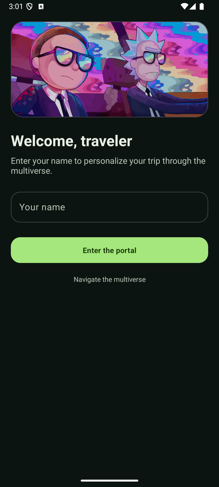
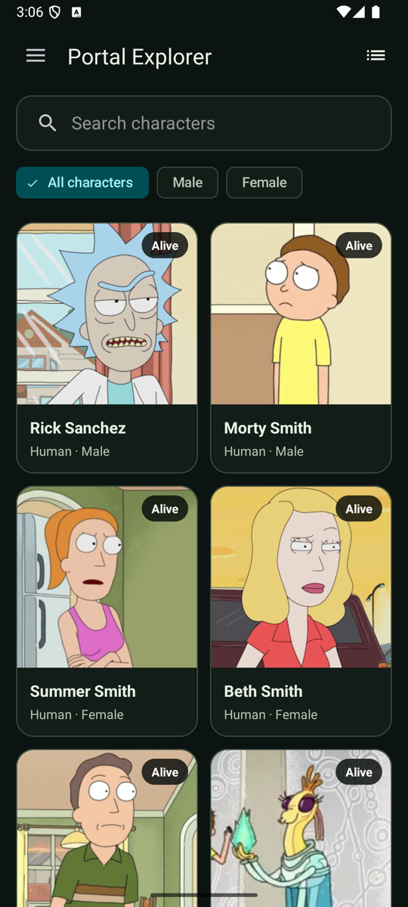
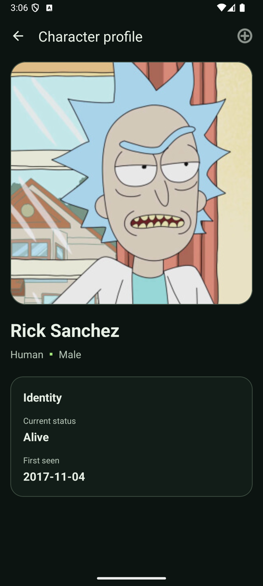
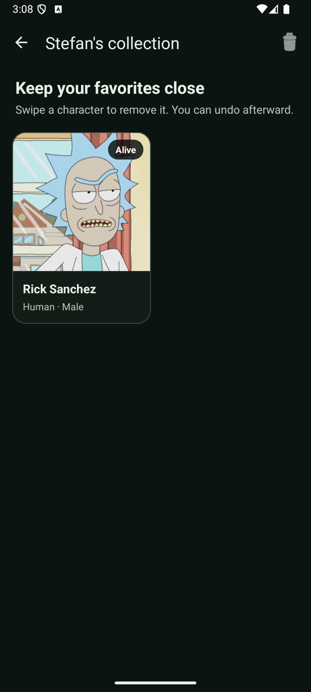
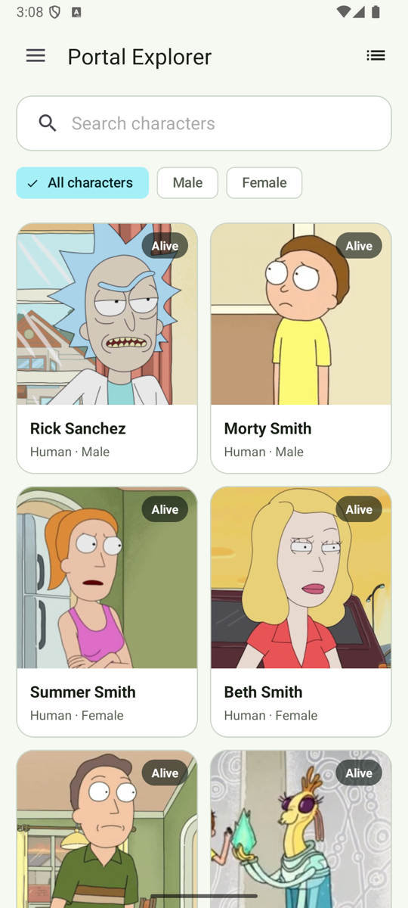
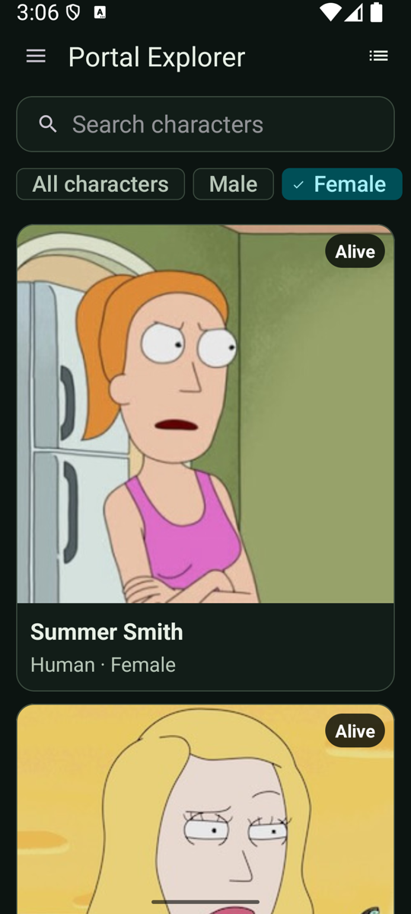
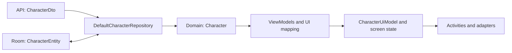

# Rick and Morty Android MVVM

An Android learning project for browsing, searching, filtering, and saving characters from the [Rick
and Morty API](https://rickandmortyapi.com/).

I started this project to learn MVVM. Later updates added:

- Paging 3 with shared filter state, lifecycle-aware collection, loading and error states, and tests
  for page keys.
- Edge-to-edge layouts with status-bar, navigation-bar, display-cutout, and keyboard insets.
- Material 3 layouts with light and dark themes, character cards, and empty and loading states.
- Separate API, database, domain, and UI models, with explicit mapping and ViewModel-owned screen
  state.

The app uses Android Views. It is a reference for adding pagination and inset handling to an
existing Views project.

## Screenshots

| Welcome screen | Character browser | Character details |
| --- | --- | --- |
|  |  |  |

| Saved characters | Light theme | Larger text (150%) |
| --- | --- | --- |
|  |  |  |

## Features

- Browse characters with paginated network loading.
- Search by character name.
- Filter results with visible All characters, Male, and Female chips.
- Open saved characters directly from the browser toolbar.
- Adapt the card grid to wider screens and use one column for larger system text.
- Wrap character names and descriptions as their content grows.
- Display initial loading, empty, refresh-error, append-loading, and append-error states.
- Retry failed initial and incremental loads.
- View character details.
- Save characters locally with Room.
- View saved characters and remove one with swipe-to-delete and undo.
- Delete all saved characters after confirmation.
- Store and display a local profile name with `SharedPreferences`.
- Open Rick and Morty web and YouTube pages or share the app through Android intents.
- Render consistently edge to edge across the intro, login, list, details, drawer, and
  saved-character screens.

## Architecture

The character feature uses MVVM with a domain repository contract and a data implementation. Each
layer owns its models.



```text
app/src/main/java/com/example/rickandmortymvvm/
├── core/                    Shared utilities
├── data/
│   ├── api/                 Retrofit service and DTO PagingSource
│   ├── db/                  Room database and entity DAO
│   └── character/
│       ├── model/           API DTOs and Room entity
│       ├── mapper/          Data/domain conversions
│       └── repository/      CharacterRepository implementation
├── di/                      Hilt providers
├── domain/character/
│   ├── model/               Plain character values and gender filter
│   └── repository/          CharacterRepository contract
└── presentation/
    ├── character/
    │   ├── model/           UI models, filters, and screen state
    │   └── mapper/          Domain-to-UI display mapping
    ├── view/                Activities and adapters
    └── viewmodel/           Paging, profile, and collection state
```

## Models and screen state

`CharacterDto` describes JSON, `CharacterEntity` describes storage, and `Character` contains the
domain values. The ViewModels map domain values to `CharacterUiModel` before publishing them to
screens. Display labels and the first-seen date are formatted in the UI mapper.

Screens navigate with a character ID. The repository looks in Room, then a bounded process cache,
then the API. Saved profiles can open offline, and a recently displayed character can open without
repeating its network request. The cache does not survive Android restarting the process.

The profile and collection each expose one immutable screen state through `StateFlow`. Save success
is published after the write finishes. Failed writes clear progress and expose an error; undo keeps
the original domain character in the ViewModel. Activities collect while started and acknowledge
displayed result messages.

See [Model boundaries and state ownership](docs/model-boundaries.md) for the mapping rules,
persistence compatibility, and production tradeoffs.

## Paging 3 reference flow

The character list is driven by a single `CharacterFilters` value containing the current search
query and gender. That value is stored in `SavedStateHandle`, so it survives Activity recreation and
process restoration.

```text
CharacterFilters StateFlow
        ↓
flatMapLatest — cancel the obsolete Pager when filters change
        ↓
CharacterRepository.searchCharacters()
        ↓
Pager.flow: CharacterDto → Character
        ↓
PagingData.map: Character → CharacterUiModel
        ↓
cachedIn(viewModelScope)
        ↓
repeatOnLifecycle(STARTED)
        ↓
PagingDataAdapter.submitData()
```

The paging implementation follows these rules:

- `flatMapLatest` cancels the previous paging stream when the search query or gender filter changes.
- `cachedIn(viewModelScope)` is applied after switching paging streams.
- The Activity has one PagingData collector instead of separate observers for each filter.
- Filter chips render the ViewModel's selection. Their checked state is not restored separately by
  the views, which prevents screen recreation from changing the active filter.
- `PagingDataAdapter` and `DiffUtil` own list updates; `notifyDataSetChanged()` is not used.
- `PagingSource` uses the API's `info.next` and `info.prev` metadata rather than guessing from item
  count.
- Refresh errors are rendered by the screen, while prepend and append errors are rendered by
  `LoadStateAdapter` instances.
- Opening Details or Saved does not destroy the list Activity, allowing the ViewModel cache and
  scroll state to remain available.

The Rick and Morty API returns HTTP 404 when a character filter has no matches. The paging source
converts that response into an empty final page. This behavior depends on the API's search contract;
other services may use 404 for a different error.

## Edge-to-edge layouts

Every Activity calls `enableEdgeToEdge()` and then applies insets to the view that owns each safe
area:

- App-bar containers receive the status-bar and display-cutout top inset.
- RecyclerViews and detail content receive the navigation-bar bottom inset.
- Full-screen intro and login layouts receive all system-bar edges.
- The login screen also responds to IME insets so the keyboard does not cover its content.
- The navigation drawer handles its own safe-area padding.

The shared inset helper records the original XML padding before adding system insets. That prevents
padding from accumulating when Android redispatches insets after rotation, keyboard changes, or
navigation-mode changes.

## Technology

| Area | Implementation |
| --- | --- |
| Language | Kotlin |
| UI | XML layouts, View Binding, Material 3 |
| Architecture | MVVM-style Activities, ViewModels, repository |
| Pagination | Paging 3, `PagingSource`, `PagingDataAdapter`, load states |
| Async state | Coroutines, Flow, StateFlow |
| Networking | Retrofit, OkHttp, Gson |
| Persistence | Room, SharedPreferences |
| Dependency injection | Hilt |
| Images | Glide |
| Minimum Android version | API 21 |
| Compile / target SDK | 36 / 35 |
| Java | Gradle daemon: JDK 21; Java/Kotlin bytecode: 17 |

## Getting started

### Requirements

- Android Studio with Android SDK 36 installed.
- JDK 21 for the configured Gradle daemon.
- An emulator or device running API 21 or newer.

The public character API does not require an API key.

### Clone and build

```bash
git clone git@github.com:GetRighhttt/RickAndMortyAndroidMVVM.git
cd RickAndMortyAndroidMVVM
./gradlew assembleDebug
```

Alternatively, open the repository in Android Studio, allow Gradle sync to finish, and run the `app`
configuration.

## Tests

Run the local unit tests with:

```bash
./gradlew testDebugUnitTest
```

The tests cover page keys, terminal and empty pages, HTTP errors, and refresh anchors. Repository
tests check field mapping, local profile lookup, the process cache, and stable character IDs. UI
mapper and ViewModel tests cover display values, delayed and failed saves, duplicate save taps,
cancellation, load retry, and undo using original domain values.

To build and test together:

```bash
./gradlew testDebugUnitTest assembleDebug
```

## What to change for production

Before using this project in a production app:

- Use a `RemoteMediator` and a database-backed source of truth if paged content must work offline.
- Replace the local profile-name screen with real authentication if identity is required.
- Add explicit Room migrations when changing the saved-character schema. Destructive fallback is
  disabled.
- Disable BODY-level HTTP logging in release builds.
- Configure real release signing; this project currently uses debug signing for the release build
  type.
- Add instrumentation/UI tests for loading, retry, rotation, keyboard, cutout, gesture-navigation,
  and three-button-navigation behavior.
- Choose a persistent source of truth if unsaved profiles must reopen offline after a process
  restart; the current character cache is in memory.
- Review and upgrade the Gradle, Kotlin, KSP, AndroidX, networking, and DI versions as a separate
  migration.
- Check whether older dependencies and classes are still used before removing them.

The build still has legacy plugin and deprecation warnings. The Paging 3 and edge-to-edge updates
did not include a toolchain migration.

## Demo videos

- [Character browsing, searching, saving, and
  deletion](https://github.com/GetRighhttt/RickAndMortyAndroidMVVM/assets/105057858/939ae1b9-07a6-43a7-8bcc-2da9239e070a)
- [Local profile name and saved-character
  persistence](https://github.com/GetRighhttt/RickAndMortyAndroidMVVM/assets/105057858/a19c935f-0326-484b-abe4-7ec156bab42d)
- [YouTube, website, and Android share
  intents](https://github.com/GetRighhttt/RickAndMortyAndroidMVVM/assets/105057858/e248d78f-b601-487b-963f-ebdcfc50e541)

The videos show earlier versions of the app.

## Contributing

For changes intended as reference material:

1. Keep the sample focused and explain non-obvious lifecycle or API-contract decisions.
2. Add or update tests for the changed responsibility: data mappings, paging, or ViewModel state.
3. Run `./gradlew testDebugUnitTest assembleDebug`.
4. Open a pull request describing the behavior change and the reason for it.

## Attribution

Character data and images are provided by the [Rick and Morty API](https://rickandmortyapi.com/).
This is an unofficial learning project and is not affiliated with the API maintainers, Adult Swim,
or the creators of Rick and Morty.

## Contact

Questions and comments: stefanbusiness95@gmail.com
